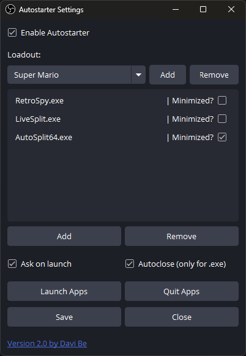
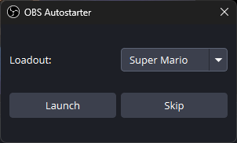
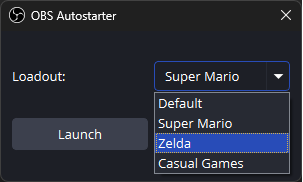

<h1 align="center"> Autostarter for OBS </h1><br>
<p align="center">
    
</p>
</br>

Plugin for OBS Studio that automatically launches and quits programs alongside OBS. Perfect for streamers and content creators who need to start multiple applications when beginning their streaming or recording sessions.


## Features

- 🚀 Automatically launch programs when OBS starts
- 🎯 Save multiple loadouts for different scenarios
- 📱 Launch multiple programs per loadout
- ⚙️ Highly configurable launch options:
  - 🔽 Launch programs minimized
  - 🔄 Per-app auto-close when OBS exits
  - ⏱️ Ordered launches with optional delays
  - ⌨️ Command-line arguments for executables and shortcuts
  - 🔎 Search shortcuts from the Windows Start menu
  - 💬 Optional launch confirmation dialog
- 🎮 Launch and quit programs directly from OBS
- 💻 Command line support (`--autostarter "loadoutname"`)

#### Settings



#### Launch Dialog

 


## Improvements over the old Lua Script

- ✨ Native C++ implementation for better performance
- 📦 Multiple loadout support
- 💬 Added launch confirmation option
- 🔧 More configuration options
- 🛠️ Full process management with proper termination
- 🔍 Prevents duplicate programm launches
- ⚡ Faster startup and response times
- 🖥️ Modern UI with better usability

## System Requirements

- Windows 10 or later
- OBS Studio 30.1.2 or later
- 64-bit system

## Installation

Close OBS Studio before installing or updating Autostarter. Download the Windows x64 package for your setup.

- **OBS Studio 33 or later.** Extract the ZIP ending in `-obs33.zip` into `C:\ProgramData\obs-studio\plugins`. The DLL should be at `C:\ProgramData\obs-studio\plugins\autostarter\autostarter.dll`. For a portable OBS 33 installation, extract it into the `plugins` folder in your portable OBS root.
- **OBS Studio 30–32 or AshuraStrike's Plugin Manager.** Use the Windows ZIP without the `-obs33` suffix. Extract it into the OBS installation folder or import it into the manager. The archive contains `obs-plugins/64bit/autostarter.dll` in the layout that manager expects. OBS 33 reports this layout as legacy.

Start OBS and open **Tools → Autostarter**. See the [OBS plugin directory guide](https://obsproject.com/kb/legacy-plugin-developer-info) for details on the OBS 33 layout.

## Usage

1. Open OBS Studio
2. Go to Tools → Autostarter
3. Check Enable Autostarter
4. Create a new loadout or use the default one
5. Use **Start Menu…** to search shortcuts from your account and the shared Start menu, or **Browse Files…** to select a file directly.
6. Set the order with **Move Up** and **Move Down**, and configure each program's delay, arguments and auto-close settings.
7. Save your settings

## Configuration

- **Loadouts**: Create multiple program groups for different scenarios
- **Launch order.** Apps start from top to bottom. A delay applies before that app's launch, measured from the previous launch attempt. For example, put A first at `0 s` and B second at `5 s`. A delay does not check whether A has finished loading. **Quit Apps** or OBS shutdown cancels pending launches.
- **Arguments.** Use **Args…** and enter only the arguments, such as `--profile "My Profile"`. For a shortcut targeting an executable, these are appended to its existing arguments and its working directory is preserved.
- **Auto-close.** Enable **Auto-close on OBS exit**, then check **Auto-close** for the apps you want closed. Per-app choices are captured when each app is launched. Autostarter closes only the executable processes it started and their tracked descendants. Shortcuts handed directly to Windows and other files can open in an existing application, so their processes cannot be tracked. The Start menu picker lists file-based shortcuts, so some Store apps may be missing.
- **Launch prompt and minimized windows.** Choose **Ask on launch** for a loadout prompt and **Minimized** for individual apps. Windows apps can override the requested window state.
- **Command Line**: 
  Start OBS with a specific loadout using:
  ```
  obs64.exe --autostarter "loadoutname"
  ```
  This will bypass the enabled state and launch dialog, always launching the specified loadout.

## Startup performance

Autostarter queues the startup launch after OBS finishes loading. Each group of apps with no intervening delay shares one Windows process snapshot. The current OBS log records Autostarter's module initialization and launch timings separately. Intentional delays are excluded from the reported launch time.

## Credits

Developed with ❤️ by [Davi Be](https://github.com/DaviBe92)
